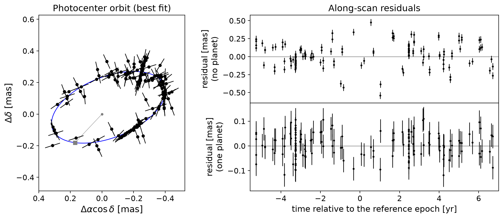

# gaiamockplus

**gaiamockplus** provides a fast forward model of Gaia epoch astrometry for stars hosting arbitrarily many planets (or other dark companions). It is built on [gaiamock](https://github.com/kareemelbadry/gaiamock). gaiamockplus can:

- simulate Gaia epoch astrometry (and RVs) of N-planet systems
- fit them: astrometry, RVs (from multiple instruments), or both jointly
- search blindly for planets with efficient, C-based optimizers
- provide likelihoods and starting points for MCMC sampling.

If you use gaiamockplus, please include a link to this repository and cite [El-Badry et al. (2024)](https://arxiv.org/abs/2411.00088).


*Simulated Gaia DR5 astrometry of a star with an 8 Jupiter-mass planet ([notebook 01](notebooks/01_single_planet_astrometry.ipynb)): the best-fit photocenter orbit (left), and the along-scan residuals of the best-fit models without (top right) and with the planet (lower right).*

## Installation

```bash
pip install git+https://github.com/CalebLammers/gaiamockplus.git
```

This compiles the package's C code, which needs a C compiler and the [GSL](https://www.gnu.org/software/gsl/) library (e.g. `brew install gsl` on macOS, or `sudo apt install libgsl-dev` on Debian/Ubuntu). macOS and Linux are supported. For development, clone the repository and run `pip install -e .`.

The first time Gaia's scanning law is needed, gaiamockplus downloads it automatically to `~/.gaiamockplus` (984 MB unzipped). To use an existing copy of gaiamock's `healpix_scans/` folder instead, set the environment variable `GAIAMOCKPLUS_DATA` to the folder that contains it.

The example notebooks also need `emcee` and `corner`, and notebook 07 needs `dynesty` (`pip install emcee corner dynesty`).

## Examples

- [01_single_planet_astrometry](notebooks/01_single_planet_astrometry.ipynb): simulate and fit the astrometry of a single-planet system, and sample the posterior with MCMC.
- [02_two_planet_astrometry](notebooks/02_two_planet_astrometry.ipynb): a blind search for astrometric planets in a two-planet system.
- [03_single_planet_astrometry_and_rvs](notebooks/03_single_planet_astrometry_and_rvs.ipynb): RVs from three instruments, fit alone and jointly with the astrometry.
- [04_two_planet_astrometry_and_rvs](notebooks/04_two_planet_astrometry_and_rvs.ipynb): two planets with astrometry and RVs, and their mutual inclination.
- [05_transiting_planet_and_astrometric_giant](notebooks/05_transiting_planet_and_astrometric_giant.ipynb): a transiting planet, an astrometric giant, and their minimum mutual inclination.
- [06_gaia4b_dr4_astrometry_and_rvs](notebooks/06_gaia4b_dr4_astrometry_and_rvs.ipynb): a joint fit of Gaia-4's RV datasets and pre-release epoch astrometry.
- [07_nested_sampling_astrometry_and_rvs](notebooks/07_nested_sampling_astrometry_and_rvs.ipynb): joint fit of RVs and astrometry with nested sampling (dynesty).

## Contact

Questions/requests can be sent to caleb [dot] lammers [at] princeton [dot] edu.
